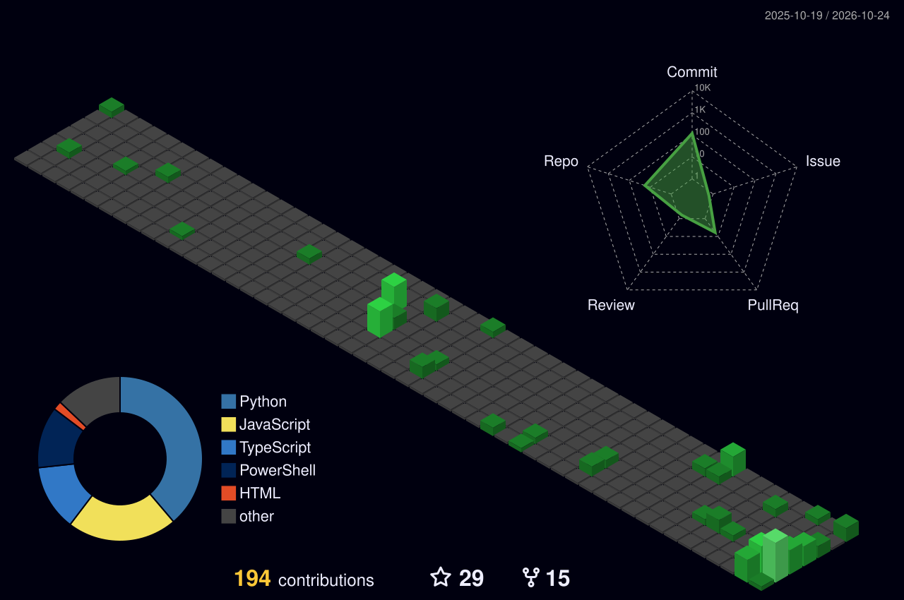

<a href="https://guranshdeol.tech"></a>

<p align="center"><sub>Full report → <a href="https://guranshdeol.tech"><b>guranshdeol.tech</b></a></sub></p>

### `$ ncc stats --show contributions,streak`

<p align="center">
  
  
</p>

### `$ ncc topology --view contributions --3d`



### `$ lsmod | grep guranshdeol`

<p>
  
  
</p>

### `$ tail -f /var/log/guranshdeol/activity.log`

<!--START_SECTION:activity-->
1. 🎉 Merged PR [#4](https://github.com/guranshdeol/out-of-office-scheduler/pull/4) in [guranshdeol/out-of-office-scheduler](https://github.com/guranshdeol/out-of-office-scheduler)
2. 💪 Opened PR [#4](https://github.com/guranshdeol/out-of-office-scheduler/pull/4) in [guranshdeol/out-of-office-scheduler](https://github.com/guranshdeol/out-of-office-scheduler)
3. 🎉 Merged PR [#2](https://github.com/guranshdeol/out-of-office-scheduler/pull/2) in [guranshdeol/out-of-office-scheduler](https://github.com/guranshdeol/out-of-office-scheduler)
4. 🎉 Merged PR [#3](https://github.com/guranshdeol/out-of-office-scheduler/pull/3) in [guranshdeol/out-of-office-scheduler](https://github.com/guranshdeol/out-of-office-scheduler)
5. 💪 Opened PR [#3](https://github.com/guranshdeol/out-of-office-scheduler/pull/3) in [guranshdeol/out-of-office-scheduler](https://github.com/guranshdeol/out-of-office-scheduler)
<!--END_SECTION:activity-->

**🎥 uploads/**
<!-- YOUTUBE:START -->
- [AI Distillation Explained: How AI Models Get Copied](https://www.youtube.com/watch?v=xTxYn6Siwfo)
- [Build Your Own MCP Server in 5 Minutes (Python + Claude Code)](https://www.youtube.com/watch?v=k7Tv0l51UUs)
- [What Is an MCP Server? Set Up Your First One in Claude Code (Beginner's Guide)](https://www.youtube.com/watch?v=_a7QyIm6HGo)
<!-- YOUTUBE:END -->

**✍️ posts/**
<!-- BLOG:START -->
- [Many alerts, one cause: an incident responder built on a FalkorDB graph](https://guranshdeol.hashnode.dev/many-alerts-one-cause-an-incident-responder-built-on-a-falkordb-graph)
- [Day 23 of #100DaysOfCode: Deep Dive into the TCP/IP Model's Application Layer](https://guranshdeol.hashnode.dev/day23-tcp)
- [#100DaysOfCode: Days 20-22 - Networking Fundamentals](https://guranshdeol.hashnode.dev/days-20-22)
<!-- BLOG:END -->

### `$ echo $HOME $WORKDIR`

```geojson
{
  "type": "FeatureCollection",
  "features": [
    { "type": "Feature", "properties": { "name": "HOME=Punjab" }, "geometry": { "type": "Point", "coordinates": [75.8573, 30.9010] } },
    { "type": "Feature", "properties": { "name": "WORKDIR=Bengaluru" }, "geometry": { "type": "Point", "coordinates": [77.5946, 12.9716] } },
    { "type": "Feature", "properties": { "name": "commute" }, "geometry": { "type": "LineString", "coordinates": [[75.8573, 30.9010], [77.5946, 12.9716]] } }
  ]
}
```

### `$ cat node-01.stl`  <sub>drag to rotate</sub>

```stl
solid node01
facet normal 0 0 -1
outer loop
vertex 0 0 0
vertex 0 30 0
vertex 44 30 0
endloop
endfacet
facet normal 0 0 -1
outer loop
vertex 0 0 0
vertex 44 30 0
vertex 44 0 0
endloop
endfacet
facet normal 0 0 1
outer loop
vertex 0 0 4.4
vertex 44 0 4.4
vertex 44 30 4.4
endloop
endfacet
facet normal 0 0 1
outer loop
vertex 0 0 4.4
vertex 44 30 4.4
vertex 0 30 4.4
endloop
endfacet
facet normal 0 -1 0
outer loop
vertex 0 0 0
vertex 44 0 0
vertex 44 0 4.4
endloop
endfacet
facet normal 0 -1 0
outer loop
vertex 0 0 0
vertex 44 0 4.4
vertex 0 0 4.4
endloop
endfacet
facet normal 0 1 0
outer loop
vertex 0 30 0
vertex 0 30 4.4
vertex 44 30 4.4
endloop
endfacet
facet normal 0 1 0
outer loop
vertex 0 30 0
vertex 44 30 4.4
vertex 44 30 0
endloop
endfacet
facet normal -1 0 0
outer loop
vertex 0 0 0
vertex 0 0 4.4
vertex 0 30 4.4
endloop
endfacet
facet normal -1 0 0
outer loop
vertex 0 0 0
vertex 0 30 4.4
vertex 0 30 0
endloop
endfacet
facet normal 1 0 0
outer loop
vertex 44 0 0
vertex 44 30 0
vertex 44 30 4.4
endloop
endfacet
facet normal 1 0 0
outer loop
vertex 44 0 0
vertex 44 30 4.4
vertex 44 0 4.4
endloop
endfacet
facet normal 0 0 -1
outer loop
vertex 3 -0.6 0.6
vertex 3 0 0.6
vertex 6.8 0 0.6
endloop
endfacet
facet normal 0 0 -1
outer loop
vertex 3 -0.6 0.6
vertex 6.8 0 0.6
vertex 6.8 -0.6 0.6
endloop
endfacet
facet normal 0 0 1
outer loop
vertex 3 -0.6 3.8
vertex 6.8 -0.6 3.8
vertex 6.8 0 3.8
endloop
endfacet
facet normal 0 0 1
outer loop
vertex 3 -0.6 3.8
vertex 6.8 0 3.8
vertex 3 0 3.8
endloop
endfacet
facet normal 0 -1 0
outer loop
vertex 3 -0.6 0.6
vertex 6.8 -0.6 0.6
vertex 6.8 -0.6 3.8
endloop
endfacet
facet normal 0 -1 0
outer loop
vertex 3 -0.6 0.6
vertex 6.8 -0.6 3.8
vertex 3 -0.6 3.8
endloop
endfacet
facet normal 0 1 0
outer loop
vertex 3 0 0.6
vertex 3 0 3.8
vertex 6.8 0 3.8
endloop
endfacet
facet normal 0 1 0
outer loop
vertex 3 0 0.6
vertex 6.8 0 3.8
vertex 6.8 0 0.6
endloop
endfacet
facet normal -1 0 0
outer loop
vertex 3 -0.6 0.6
vertex 3 -0.6 3.8
vertex 3 0 3.8
endloop
endfacet
facet normal -1 0 0
outer loop
vertex 3 -0.6 0.6
vertex 3 0 3.8
vertex 3 0 0.6
endloop
endfacet
facet normal 1 0 0
outer loop
vertex 6.8 -0.6 0.6
vertex 6.8 0 0.6
vertex 6.8 0 3.8
endloop
endfacet
facet normal 1 0 0
outer loop
vertex 6.8 -0.6 0.6
vertex 6.8 0 3.8
vertex 6.8 -0.6 3.8
endloop
endfacet
facet normal 0 0 -1
outer loop
vertex 7.6 -0.6 0.6
vertex 7.6 0 0.6
vertex 11.4 0 0.6
endloop
endfacet
facet normal 0 0 -1
outer loop
vertex 7.6 -0.6 0.6
vertex 11.4 0 0.6
vertex 11.4 -0.6 0.6
endloop
endfacet
facet normal 0 0 1
outer loop
vertex 7.6 -0.6 3.8
vertex 11.4 -0.6 3.8
vertex 11.4 0 3.8
endloop
endfacet
facet normal 0 0 1
outer loop
vertex 7.6 -0.6 3.8
vertex 11.4 0 3.8
vertex 7.6 0 3.8
endloop
endfacet
facet normal 0 -1 0
outer loop
vertex 7.6 -0.6 0.6
vertex 11.4 -0.6 0.6
vertex 11.4 -0.6 3.8
endloop
endfacet
facet normal 0 -1 0
outer loop
vertex 7.6 -0.6 0.6
vertex 11.4 -0.6 3.8
vertex 7.6 -0.6 3.8
endloop
endfacet
facet normal 0 1 0
outer loop
vertex 7.6 0 0.6
vertex 7.6 0 3.8
vertex 11.4 0 3.8
endloop
endfacet
facet normal 0 1 0
outer loop
vertex 7.6 0 0.6
vertex 11.4 0 3.8
vertex 11.4 0 0.6
endloop
endfacet
facet normal -1 0 0
outer loop
vertex 7.6 -0.6 0.6
vertex 7.6 -0.6 3.8
vertex 7.6 0 3.8
endloop
endfacet
facet normal -1 0 0
outer loop
vertex 7.6 -0.6 0.6
vertex 7.6 0 3.8
vertex 7.6 0 0.6
endloop
endfacet
facet normal 1 0 0
outer loop
vertex 11.4 -0.6 0.6
vertex 11.4 0 0.6
vertex 11.4 0 3.8
endloop
endfacet
facet normal 1 0 0
outer loop
vertex 11.4 -0.6 0.6
vertex 11.4 0 3.8
vertex 11.4 -0.6 3.8
endloop
endfacet
facet normal 0 0 -1
outer loop
vertex 12.2 -0.6 0.6
vertex 12.2 0 0.6
vertex 16 0 0.6
endloop
endfacet
facet normal 0 0 -1
outer loop
vertex 12.2 -0.6 0.6
vertex 16 0 0.6
vertex 16 -0.6 0.6
endloop
endfacet
facet normal 0 0 1
outer loop
vertex 12.2 -0.6 3.8
vertex 16 -0.6 3.8
vertex 16 0 3.8
endloop
endfacet
facet normal 0 0 1
outer loop
vertex 12.2 -0.6 3.8
vertex 16 0 3.8
vertex 12.2 0 3.8
endloop
endfacet
facet normal 0 -1 0
outer loop
vertex 12.2 -0.6 0.6
vertex 16 -0.6 0.6
vertex 16 -0.6 3.8
endloop
endfacet
facet normal 0 -1 0
outer loop
vertex 12.2 -0.6 0.6
vertex 16 -0.6 3.8
vertex 12.2 -0.6 3.8
endloop
endfacet
facet normal 0 1 0
outer loop
vertex 12.2 0 0.6
vertex 12.2 0 3.8
vertex 16 0 3.8
endloop
endfacet
facet normal 0 1 0
outer loop
vertex 12.2 0 0.6
vertex 16 0 3.8
vertex 16 0 0.6
endloop
endfacet
facet normal -1 0 0
outer loop
vertex 12.2 -0.6 0.6
vertex 12.2 -0.6 3.8
vertex 12.2 0 3.8
endloop
endfacet
facet normal -1 0 0
outer loop
vertex 12.2 -0.6 0.6
vertex 12.2 0 3.8
vertex 12.2 0 0.6
endloop
endfacet
facet normal 1 0 0
outer loop
vertex 16 -0.6 0.6
vertex 16 0 0.6
vertex 16 0 3.8
endloop
endfacet
facet normal 1 0 0
outer loop
vertex 16 -0.6 0.6
vertex 16 0 3.8
vertex 16 -0.6 3.8
endloop
endfacet
facet normal 0 0 -1
outer loop
vertex 16.8 -0.6 0.6
vertex 16.8 0 0.6
vertex 20.6 0 0.6
endloop
endfacet
facet normal 0 0 -1
outer loop
vertex 16.8 -0.6 0.6
vertex 20.6 0 0.6
vertex 20.6 -0.6 0.6
endloop
endfacet
facet normal 0 0 1
outer loop
vertex 16.8 -0.6 3.8
vertex 20.6 -0.6 3.8
vertex 20.6 0 3.8
endloop
endfacet
facet normal 0 0 1
outer loop
vertex 16.8 -0.6 3.8
vertex 20.6 0 3.8
vertex 16.8 0 3.8
endloop
endfacet
facet normal 0 -1 0
outer loop
vertex 16.8 -0.6 0.6
vertex 20.6 -0.6 0.6
vertex 20.6 -0.6 3.8
endloop
endfacet
facet normal 0 -1 0
outer loop
vertex 16.8 -0.6 0.6
vertex 20.6 -0.6 3.8
vertex 16.8 -0.6 3.8
endloop
endfacet
facet normal 0 1 0
outer loop
vertex 16.8 0 0.6
vertex 16.8 0 3.8
vertex 20.6 0 3.8
endloop
endfacet
facet normal 0 1 0
outer loop
vertex 16.8 0 0.6
vertex 20.6 0 3.8
vertex 20.6 0 0.6
endloop
endfacet
facet normal -1 0 0
outer loop
vertex 16.8 -0.6 0.6
vertex 16.8 -0.6 3.8
vertex 16.8 0 3.8
endloop
endfacet
facet normal -1 0 0
outer loop
vertex 16.8 -0.6 0.6
vertex 16.8 0 3.8
vertex 16.8 0 0.6
endloop
endfacet
facet normal 1 0 0
outer loop
vertex 20.6 -0.6 0.6
vertex 20.6 0 0.6
vertex 20.6 0 3.8
endloop
endfacet
facet normal 1 0 0
outer loop
vertex 20.6 -0.6 0.6
vertex 20.6 0 3.8
vertex 20.6 -0.6 3.8
endloop
endfacet
facet normal 0 0 -1
outer loop
vertex 21.4 -0.6 0.6
vertex 21.4 0 0.6
vertex 25.2 0 0.6
endloop
endfacet
facet normal 0 0 -1
outer loop
vertex 21.4 -0.6 0.6
vertex 25.2 0 0.6
vertex 25.2 -0.6 0.6
endloop
endfacet
facet normal 0 0 1
outer loop
vertex 21.4 -0.6 3.8
vertex 25.2 -0.6 3.8
vertex 25.2 0 3.8
endloop
endfacet
facet normal 0 0 1
outer loop
vertex 21.4 -0.6 3.8
vertex 25.2 0 3.8
vertex 21.4 0 3.8
endloop
endfacet
facet normal 0 -1 0
outer loop
vertex 21.4 -0.6 0.6
vertex 25.2 -0.6 0.6
vertex 25.2 -0.6 3.8
endloop
endfacet
facet normal 0 -1 0
outer loop
vertex 21.4 -0.6 0.6
vertex 25.2 -0.6 3.8
vertex 21.4 -0.6 3.8
endloop
endfacet
facet normal 0 1 0
outer loop
vertex 21.4 0 0.6
vertex 21.4 0 3.8
vertex 25.2 0 3.8
endloop
endfacet
facet normal 0 1 0
outer loop
vertex 21.4 0 0.6
vertex 25.2 0 3.8
vertex 25.2 0 0.6
endloop
endfacet
facet normal -1 0 0
outer loop
vertex 21.4 -0.6 0.6
vertex 21.4 -0.6 3.8
vertex 21.4 0 3.8
endloop
endfacet
facet normal -1 0 0
outer loop
vertex 21.4 -0.6 0.6
vertex 21.4 0 3.8
vertex 21.4 0 0.6
endloop
endfacet
facet normal 1 0 0
outer loop
vertex 25.2 -0.6 0.6
vertex 25.2 0 0.6
vertex 25.2 0 3.8
endloop
endfacet
facet normal 1 0 0
outer loop
vertex 25.2 -0.6 0.6
vertex 25.2 0 3.8
vertex 25.2 -0.6 3.8
endloop
endfacet
facet normal 0 0 -1
outer loop
vertex 26 -0.6 0.6
vertex 26 0 0.6
vertex 29.8 0 0.6
endloop
endfacet
facet normal 0 0 -1
outer loop
vertex 26 -0.6 0.6
vertex 29.8 0 0.6
vertex 29.8 -0.6 0.6
endloop
endfacet
facet normal 0 0 1
outer loop
vertex 26 -0.6 3.8
vertex 29.8 -0.6 3.8
vertex 29.8 0 3.8
endloop
endfacet
facet normal 0 0 1
outer loop
vertex 26 -0.6 3.8
vertex 29.8 0 3.8
vertex 26 0 3.8
endloop
endfacet
facet normal 0 -1 0
outer loop
vertex 26 -0.6 0.6
vertex 29.8 -0.6 0.6
vertex 29.8 -0.6 3.8
endloop
endfacet
facet normal 0 -1 0
outer loop
vertex 26 -0.6 0.6
vertex 29.8 -0.6 3.8
vertex 26 -0.6 3.8
endloop
endfacet
facet normal 0 1 0
outer loop
vertex 26 0 0.6
vertex 26 0 3.8
vertex 29.8 0 3.8
endloop
endfacet
facet normal 0 1 0
outer loop
vertex 26 0 0.6
vertex 29.8 0 3.8
vertex 29.8 0 0.6
endloop
endfacet
facet normal -1 0 0
outer loop
vertex 26 -0.6 0.6
vertex 26 -0.6 3.8
vertex 26 0 3.8
endloop
endfacet
facet normal -1 0 0
outer loop
vertex 26 -0.6 0.6
vertex 26 0 3.8
vertex 26 0 0.6
endloop
endfacet
facet normal 1 0 0
outer loop
vertex 29.8 -0.6 0.6
vertex 29.8 0 0.6
vertex 29.8 0 3.8
endloop
endfacet
facet normal 1 0 0
outer loop
vertex 29.8 -0.6 0.6
vertex 29.8 0 3.8
vertex 29.8 -0.6 3.8
endloop
endfacet
facet normal 0 0 -1
outer loop
vertex 30.6 -0.6 0.6
vertex 30.6 0 0.6
vertex 34.4 0 0.6
endloop
endfacet
facet normal 0 0 -1
outer loop
vertex 30.6 -0.6 0.6
vertex 34.4 0 0.6
vertex 34.4 -0.6 0.6
endloop
endfacet
facet normal 0 0 1
outer loop
vertex 30.6 -0.6 3.8
vertex 34.4 -0.6 3.8
vertex 34.4 0 3.8
endloop
endfacet
facet normal 0 0 1
outer loop
vertex 30.6 -0.6 3.8
vertex 34.4 0 3.8
vertex 30.6 0 3.8
endloop
endfacet
facet normal 0 -1 0
outer loop
vertex 30.6 -0.6 0.6
vertex 34.4 -0.6 0.6
vertex 34.4 -0.6 3.8
endloop
endfacet
facet normal 0 -1 0
outer loop
vertex 30.6 -0.6 0.6
vertex 34.4 -0.6 3.8
vertex 30.6 -0.6 3.8
endloop
endfacet
facet normal 0 1 0
outer loop
vertex 30.6 0 0.6
vertex 30.6 0 3.8
vertex 34.4 0 3.8
endloop
endfacet
facet normal 0 1 0
outer loop
vertex 30.6 0 0.6
vertex 34.4 0 3.8
vertex 34.4 0 0.6
endloop
endfacet
facet normal -1 0 0
outer loop
vertex 30.6 -0.6 0.6
vertex 30.6 -0.6 3.8
vertex 30.6 0 3.8
endloop
endfacet
facet normal -1 0 0
outer loop
vertex 30.6 -0.6 0.6
vertex 30.6 0 3.8
vertex 30.6 0 0.6
endloop
endfacet
facet normal 1 0 0
outer loop
vertex 34.4 -0.6 0.6
vertex 34.4 0 0.6
vertex 34.4 0 3.8
endloop
endfacet
facet normal 1 0 0
outer loop
vertex 34.4 -0.6 0.6
vertex 34.4 0 3.8
vertex 34.4 -0.6 3.8
endloop
endfacet
facet normal 0 0 -1
outer loop
vertex 35.2 -0.6 0.6
vertex 35.2 0 0.6
vertex 39 0 0.6
endloop
endfacet
facet normal 0 0 -1
outer loop
vertex 35.2 -0.6 0.6
vertex 39 0 0.6
vertex 39 -0.6 0.6
endloop
endfacet
facet normal 0 0 1
outer loop
vertex 35.2 -0.6 3.8
vertex 39 -0.6 3.8
vertex 39 0 3.8
endloop
endfacet
facet normal 0 0 1
outer loop
vertex 35.2 -0.6 3.8
vertex 39 0 3.8
vertex 35.2 0 3.8
endloop
endfacet
facet normal 0 -1 0
outer loop
vertex 35.2 -0.6 0.6
vertex 39 -0.6 0.6
vertex 39 -0.6 3.8
endloop
endfacet
facet normal 0 -1 0
outer loop
vertex 35.2 -0.6 0.6
vertex 39 -0.6 3.8
vertex 35.2 -0.6 3.8
endloop
endfacet
facet normal 0 1 0
outer loop
vertex 35.2 0 0.6
vertex 35.2 0 3.8
vertex 39 0 3.8
endloop
endfacet
facet normal 0 1 0
outer loop
vertex 35.2 0 0.6
vertex 39 0 3.8
vertex 39 0 0.6
endloop
endfacet
facet normal -1 0 0
outer loop
vertex 35.2 -0.6 0.6
vertex 35.2 -0.6 3.8
vertex 35.2 0 3.8
endloop
endfacet
facet normal -1 0 0
outer loop
vertex 35.2 -0.6 0.6
vertex 35.2 0 3.8
vertex 35.2 0 0.6
endloop
endfacet
facet normal 1 0 0
outer loop
vertex 39 -0.6 0.6
vertex 39 0 0.6
vertex 39 0 3.8
endloop
endfacet
facet normal 1 0 0
outer loop
vertex 39 -0.6 0.6
vertex 39 0 3.8
vertex 39 -0.6 3.8
endloop
endfacet
facet normal 0 0 -1
outer loop
vertex -2 -0.6 0.4
vertex -2 2 0.4
vertex 0 2 0.4
endloop
endfacet
facet normal 0 0 -1
outer loop
vertex -2 -0.6 0.4
vertex 0 2 0.4
vertex 0 -0.6 0.4
endloop
endfacet
facet normal 0 0 1
outer loop
vertex -2 -0.6 4
vertex 0 -0.6 4
vertex 0 2 4
endloop
endfacet
facet normal 0 0 1
outer loop
vertex -2 -0.6 4
vertex 0 2 4
vertex -2 2 4
endloop
endfacet
facet normal 0 -1 0
outer loop
vertex -2 -0.6 0.4
vertex 0 -0.6 0.4
vertex 0 -0.6 4
endloop
endfacet
facet normal 0 -1 0
outer loop
vertex -2 -0.6 0.4
vertex 0 -0.6 4
vertex -2 -0.6 4
endloop
endfacet
facet normal 0 1 0
outer loop
vertex -2 2 0.4
vertex -2 2 4
vertex 0 2 4
endloop
endfacet
facet normal 0 1 0
outer loop
vertex -2 2 0.4
vertex 0 2 4
vertex 0 2 0.4
endloop
endfacet
facet normal -1 0 0
outer loop
vertex -2 -0.6 0.4
vertex -2 -0.6 4
vertex -2 2 4
endloop
endfacet
facet normal -1 0 0
outer loop
vertex -2 -0.6 0.4
vertex -2 2 4
vertex -2 2 0.4
endloop
endfacet
facet normal 1 0 0
outer loop
vertex 0 -0.6 0.4
vertex 0 2 0.4
vertex 0 2 4
endloop
endfacet
facet normal 1 0 0
outer loop
vertex 0 -0.6 0.4
vertex 0 2 4
vertex 0 -0.6 4
endloop
endfacet
facet normal 0 0 -1
outer loop
vertex 44 -0.6 0.4
vertex 44 2 0.4
vertex 46 2 0.4
endloop
endfacet
facet normal 0 0 -1
outer loop
vertex 44 -0.6 0.4
vertex 46 2 0.4
vertex 46 -0.6 0.4
endloop
endfacet
facet normal 0 0 1
outer loop
vertex 44 -0.6 4
vertex 46 -0.6 4
vertex 46 2 4
endloop
endfacet
facet normal 0 0 1
outer loop
vertex 44 -0.6 4
vertex 46 2 4
vertex 44 2 4
endloop
endfacet
facet normal 0 -1 0
outer loop
vertex 44 -0.6 0.4
vertex 46 -0.6 0.4
vertex 46 -0.6 4
endloop
endfacet
facet normal 0 -1 0
outer loop
vertex 44 -0.6 0.4
vertex 46 -0.6 4
vertex 44 -0.6 4
endloop
endfacet
facet normal 0 1 0
outer loop
vertex 44 2 0.4
vertex 44 2 4
vertex 46 2 4
endloop
endfacet
facet normal 0 1 0
outer loop
vertex 44 2 0.4
vertex 46 2 4
vertex 46 2 0.4
endloop
endfacet
facet normal -1 0 0
outer loop
vertex 44 -0.6 0.4
vertex 44 -0.6 4
vertex 44 2 4
endloop
endfacet
facet normal -1 0 0
outer loop
vertex 44 -0.6 0.4
vertex 44 2 4
vertex 44 2 0.4
endloop
endfacet
facet normal 1 0 0
outer loop
vertex 46 -0.6 0.4
vertex 46 2 0.4
vertex 46 2 4
endloop
endfacet
facet normal 1 0 0
outer loop
vertex 46 -0.6 0.4
vertex 46 2 4
vertex 46 -0.6 4
endloop
endfacet
facet normal 0 0 -1
outer loop
vertex 40 -0.4 1.4
vertex 40 0 1.4
vertex 42 0 1.4
endloop
endfacet
facet normal 0 0 -1
outer loop
vertex 40 -0.4 1.4
vertex 42 0 1.4
vertex 42 -0.4 1.4
endloop
endfacet
facet normal 0 0 1
outer loop
vertex 40 -0.4 3
vertex 42 -0.4 3
vertex 42 0 3
endloop
endfacet
facet normal 0 0 1
outer loop
vertex 40 -0.4 3
vertex 42 0 3
vertex 40 0 3
endloop
endfacet
facet normal 0 -1 0
outer loop
vertex 40 -0.4 1.4
vertex 42 -0.4 1.4
vertex 42 -0.4 3
endloop
endfacet
facet normal 0 -1 0
outer loop
vertex 40 -0.4 1.4
vertex 42 -0.4 3
vertex 40 -0.4 3
endloop
endfacet
facet normal 0 1 0
outer loop
vertex 40 0 1.4
vertex 40 0 3
vertex 42 0 3
endloop
endfacet
facet normal 0 1 0
outer loop
vertex 40 0 1.4
vertex 42 0 3
vertex 42 0 1.4
endloop
endfacet
facet normal -1 0 0
outer loop
vertex 40 -0.4 1.4
vertex 40 -0.4 3
vertex 40 0 3
endloop
endfacet
facet normal -1 0 0
outer loop
vertex 40 -0.4 1.4
vertex 40 0 3
vertex 40 0 1.4
endloop
endfacet
facet normal 1 0 0
outer loop
vertex 42 -0.4 1.4
vertex 42 0 1.4
vertex 42 0 3
endloop
endfacet
facet normal 1 0 0
outer loop
vertex 42 -0.4 1.4
vertex 42 0 3
vertex 42 -0.4 3
endloop
endfacet
endsolid node01
```

### `$ ls ~/badges`

[](https://holopin.io/@guranshdeol)

---

```text
BUGS
       Will ask "are you sure?" before rm -rf. Not a bug.

SEE ALSO
       guranshdeol.tech(1), youtube(1), hashnode(1), linkedin(1), x(1)
```

<p align="center">
  <a href="https://guranshdeol.tech">guranshdeol.tech</a> ·
  <a href="https://www.youtube.com/@deolguransh">YouTube</a> ·
  <a href="https://guranshdeol.hashnode.dev">Hashnode</a> ·
  <a href="https://www.linkedin.com/in/guranshdeol/">LinkedIn</a> ·
  <a href="https://twitter.com/guranshdeol">X</a>
</p>
