<a href="https://guranshdeol.tech"><picture><source media="(prefers-color-scheme: light)" srcset="./assets/health-check-light.svg"/></picture></a>

### `$ ncc stats`

  <picture><source media="(prefers-color-scheme: light)" srcset="https://github-readme-stats.vercel.app/api?username=guranshdeol&show_icons=true&custom_title=ncc%20stats%20%C2%B7%20guranshdeol&border_radius=10&bg_color=ffffff&title_color=1a7f37&text_color=1f2328&icon_color=1a7f37&ring_color=1a7f37&border_color=d1d9e0"/></picture>
  <picture><source media="(prefers-color-scheme: light)" srcset="https://github-readme-streak-stats.herokuapp.com/?user=guranshdeol&border_radius=10&background=ffffff&border=d1d9e0&stroke=d1d9e0&ring=1a7f37&fire=1a7f37&currStreakNum=1a7f37&currStreakLabel=1a7f37&sideNums=1f2328&sideLabels=59636e&dates=59636e"/></picture>

### `$ ncc topology`

<a href="./assets/contributions.stl"><picture><source media="(prefers-color-scheme: light)" srcset="./assets/topology-light.svg"/></picture></a>

### `$ lsmod`

  
  <picture><source media="(prefers-color-scheme: light)" srcset="https://skillicons.dev/icons?i=aws,docker,linux,py,powershell&perline=16&theme=light"/></picture>

  <picture><source media="(prefers-color-scheme: light)" srcset="https://skillicons.dev/icons?i=bash,githubactions,fastapi,ts,react,nextjs,electron,cpp,mysql,raspberrypi&perline=16&theme=light"/></picture>

### `$ tail activity.log`

<!-- ACTIVITY:START -->
1. 🎉 Merged 4 PRs [#1](https://github.com/guranshdeol/out-of-office-scheduler/pull/1) [#2](https://github.com/guranshdeol/out-of-office-scheduler/pull/2) [#3](https://github.com/guranshdeol/out-of-office-scheduler/pull/3) [#4](https://github.com/guranshdeol/out-of-office-scheduler/pull/4) in [out-of-office-scheduler](https://github.com/guranshdeol/out-of-office-scheduler)
2. ✍️ Published [Many alerts, one cause: an incident responder built on a FalkorDB graph](https://guranshdeol.hashnode.dev/many-alerts-one-cause-an-incident-responder-built-on-a-falkordb-graph)
3. 🎥 Uploaded [AI Distillation Explained: How AI Models Get Copied](https://www.youtube.com/watch?v=xTxYn6Siwfo)
4. 🎥 Uploaded [Build Your Own MCP Server in 5 Minutes (Python + Claude Code)](https://www.youtube.com/watch?v=k7Tv0l51UUs)
5. 🎥 Uploaded [What Is an MCP Server? Set Up Your First One in Claude Code (Beginner's Guide)](https://www.youtube.com/watch?v=_a7QyIm6HGo)
<!-- ACTIVITY:END -->

### `$ ssh dc-blr-01`

<a href="./assets/datacenter.stl"><picture><source media="(prefers-color-scheme: light)" srcset="./assets/datacenter-light.svg"/></picture></a>

### `$ ls ~/badges`

---

<pre>
<b>nutanix@cvm$</b> fortune
<!-- FORTUNE:START -->Read-only first. Write access after a human says yes.<!-- FORTUNE:END -->

<b>nutanix@cvm$</b> exit
logout
Connection to guranshdeol closed.
Reconnect at:
  <a href="https://guranshdeol.tech">guranshdeol.tech</a> · <a href="https://www.youtube.com/@deolguransh">youtube</a>
  <a href="https://guranshdeol.hashnode.dev">hashnode</a> · <a href="https://www.linkedin.com/in/guranshdeol/">linkedin</a> · <a href="https://twitter.com/guranshdeol">x</a>
</pre>
